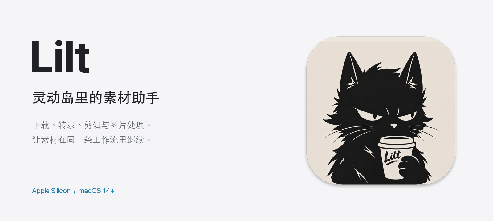
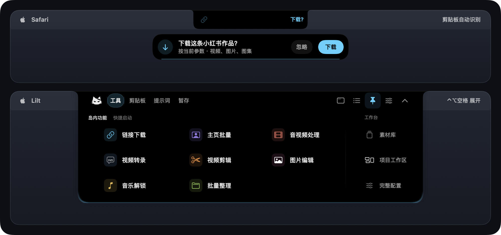
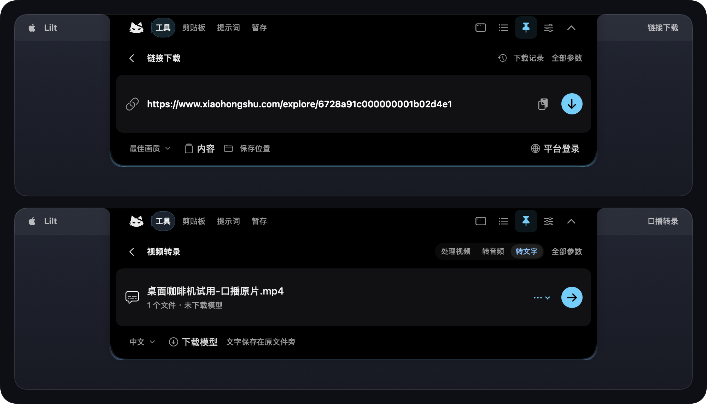
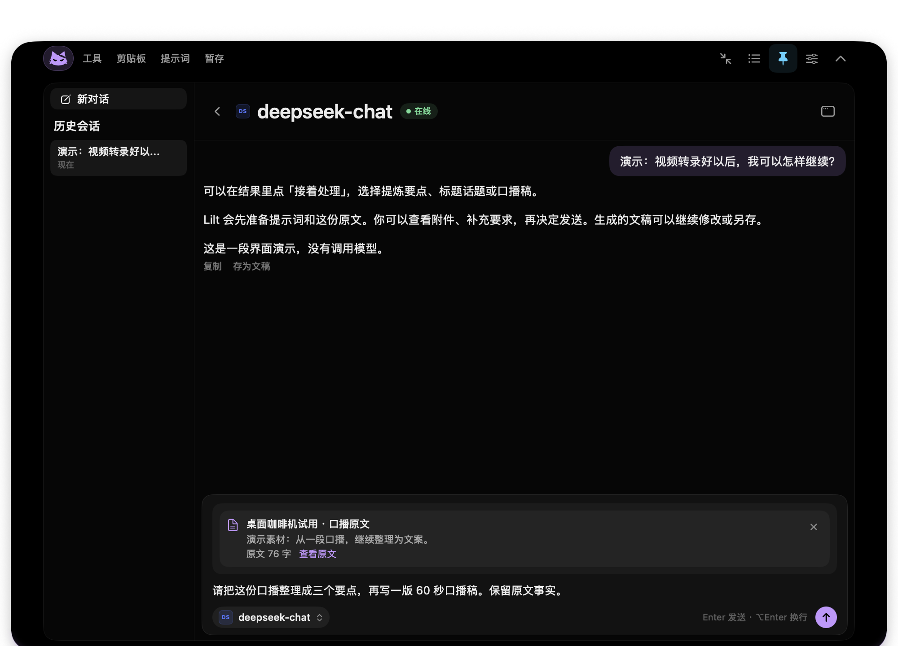
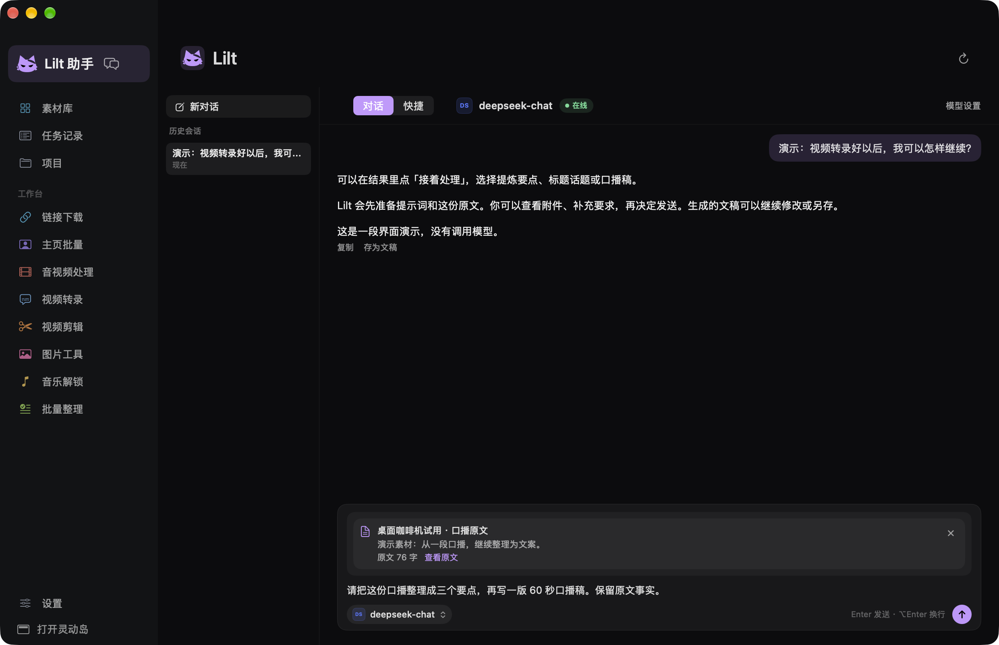
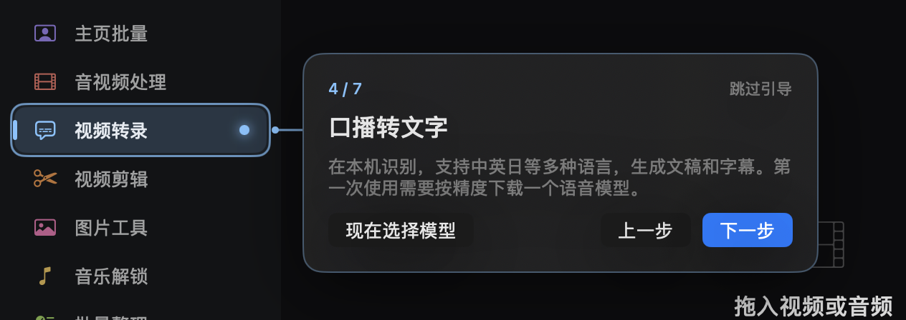

<a href="https://github.com/limyum-creator/lilt-releases/releases/tag/v0.5.16">
  <picture>
    <source media="(prefers-color-scheme: dark)" srcset="assets/lilt-cover-dark.png">
    
  </picture>
</a>

<p align="center">
  <b>从一条链接，到下一段创作。</b><br>
  为 Mac 上的短视频与新媒体创作者准备的原生灵动岛素材工具和 AI 助手。
</p>

<p align="center">
  <a href="https://github.com/limyum-creator/lilt-releases/releases/tag/v0.5.16"></a>
  
  
  
</p>

<h3 align="center">
  <a href="https://github.com/limyum-creator/lilt-releases/releases/download/v0.5.16/Lilt-0.5.16-macOS-arm64.dmg">下载 Lilt 0.5.16</a>
</h3>
<p align="center">
  <a href="docs/QUICKSTART.md">快速上手</a> &nbsp;·&nbsp;
  <a href="https://github.com/limyum-creator/lilt-releases/releases/tag/v0.5.16">更新说明</a> &nbsp;·&nbsp;
  <a href="docs/VERIFICATION.md">验证范围</a> &nbsp;·&nbsp;
  <a href="https://github.com/limyum-creator/lilt-releases/issues">反馈问题</a>
</p>

<br>

<a href="assets/lilt-island-home.png"></a>
<p align="center"><sub>灵动岛核心形态：上方为复制分享链接后的收起态与下载确认胶囊；下方为贴合屏幕刘海展开的岛内主面板（也可切换为悬浮胶囊形态）。点击可放大。</sub></p>

## 少搬运一次，创作就顺一点

下载好一条视频，想整理口播，却还要找转录工具、复制原文、打开聊天、重新解释需求。图片、文案和结果散在不同地方，每一步都要再准备一遍。

**Lilt 把这些步骤接在一起。** 随手的操作放进屏幕顶部的灵动岛，完整的素材库和参数放在工作台。结果里的「接着处理」，把刚刚处理的素材和对应提示词一起交给下一步。

> **0.5.16 / build 30** 已发布：新增截图、贴图与离线识字，完善 OpenAI 对话 / 生图及通用本地模型接入；常用模型可以多选，聊天菜单只显示勾选项。[查看这次更新](https://github.com/limyum-creator/lilt-releases/releases/tag/v0.5.16)

## 灵动岛里，随手做一点

移入屏幕顶部或按 `⌃⌥空格` 即可展开灵动岛；点击左上角猫标进入 **Lilt 助手**，也能随时切回工具、剪贴板、提示词或暂存。常用工具可以调整顺序，也能加入快捷启动。

<a href="assets/lilt-island-tools.png"></a>
<p align="center"><sub>不用打开大窗口，在屏幕顶部的灵动岛内就能直接完成链接下载、口播转文字、视频剪辑和图片裁切调色。</sub></p>

- **复制链接，接着下载。** 自动识别支持的平台分享链接并在岛下弹出确认胶囊；可一起保存标题和文案，按需要开启下载后自动转录或处理。
- **口播变成文稿。** 视频和音频在本机识别，生成 TXT 与 SRT，支持中英日等语言。语音模型按速度和精度另行选择。
- **剪一段，换个格式。** 在岛内展开时间轴选择要保留的片段，也能处理视频、提取音频或转换格式。
- **图片直接送去处理。** 岛内直接裁切调色，或使用模糊 / 纯色扩图、长图和宫格拼图；组图按整组交接。
- **截图后继续处理。** 选区截图、桌面贴图、离线识字与截图翻译；圆角、阴影、描边和快捷键按需设置，也可把截图与文字交给 Lilt 助手。
- **常用内容留在手边。** 剪贴板、提示词、素材暂存、音乐解锁与快捷启动，都有自己的岛内入口。

## Lilt 助手，让素材接着走

点击岛内最左侧猫标（或按 `⌃⌥A`），灵动岛会直接展开为 **Lilt 助手**。可以接入自己的 **OpenAI、DeepSeek、通义千问、OpenRouter、Claude 或兼容接口**；Strata、LM Studio、Ollama 等本机或局域网服务也可单独接入。模型、密钥与生图权限由你准备。

<a href="assets/lilt-island.png"></a>
<p align="center"><sub>岛内展开的 Lilt 助手界面，使用演示文本与口播原文附件。点击可放大。</sub></p>

| 你正在做的事 | Lilt 帮你接上的下一步 |
| --- | --- |
| 视频已经转录完成 | 填好提炼要点、口播稿、标题或翻译的提示词，带上原文 |
| 下载了一条图文或视频 | 携带该条标题正文改写文案，查看来源后再发送 |
| 选中了一组图片 | 将整组交给拼图、扩图，或作为生图参考 |
| 文稿需要继续修改 | 保留已有结果，继续提出修改要求，也可另存为文件 |
| 处理要分好几步 | 查找素材、读取文本、提交任务、等待完成、保存结果 |

附件会显示在输入区上方，可以查看原文、图片和文件。**交接先准备草稿，发送后才调用模型**；已主动配置的自动工作流按原设置执行。

完整模型目录在设置里管理，**勾选常用模型后，聊天菜单只显示这些模型**。支持多选、全选、全不选、仅已选和搜索，刷新目录保留勾选。未配置的服务商统一显示「未接入」。

长文可以分页读取，较早的过程整理后留有可读回记录。达到阶段边界时保留进度，同一对话可以「继续此任务」。读取外部网页文案或字幕后若触发下载、生图或写剪贴板，会先弹出确认。

<sub>这是一位围绕 Lilt 素材工具工作的专用助手。当前聊天不直接理解图片或视频画面；视频内容主要通过口播转录读取，图片可以交给处理或生图工具。脚本可以生成并另存，工具不执行终端命令或删除文件。</sub>

## 工作台里，把事情做完整

需要集中浏览素材、管理项目或调整完整工具参数时，从灵动岛一键打开 **Lilt 工作台**。

<a href="assets/lilt-workbench.png"></a>
<p align="center"><sub>Lilt 工作台主界面；对话、附件和模型配置均为展示示例，未发起收费请求。</sub></p>

- **素材库**：图片、视频与音频集中查看；空格预览，⌘ / ⇧ 多选、筛选、复制文案或拖到其他创作软件。
- **完整参数**：下载、转录、音视频、图片及其他工具保持各自的配置；窄窗口的设置分组会移到顶部。
- **任务与项目**：查看排队、进度和结果，处理失败与重试；把素材用于自己的项目。
- **MCP 接入**：从设置中复制连接配置，交给支持本地 MCP 的客户端。相关处理运行组件随应用提供。

首次使用的提示卡会跟随当前功能入口，用高亮框和引导线指明位置。想重看时，在设置中选择「重新查看新手引导」。

<a href="assets/lilt-guide.png"></a>

## 按需配置，开始用

**1. 下载并安装**

打开 [DMG 安装包](https://github.com/limyum-creator/lilt-releases/releases/download/v0.5.16/Lilt-0.5.16-macOS-arm64.dmg)，把 Lilt 拖进「应用程序」。升级前先退出旧版，数据和已有输出目录继续沿用。

**2. 先完成一件小事**

复制一条分享链接，或往屏幕顶部的灵动岛拖入一张图片、一段视频。基础素材处理不要求先接入 AI。

**3. 用到哪项，再配置哪项**

| 需要的能力 | 设置位置 | 需要准备 |
| --- | --- | --- |
| 口播转录 | 设置 → 语音模型 | 下载所选语音模型，选择识别语言 |
| Lilt 对话与文案整理 | Lilt 助手 → 模型设置 | 自己的接口、API Key 与模型 |
| AI 生图 / 改图 | 设置 → 生图模型 | 有生图权限的接口、模型与额度 |
| 需登录的平台下载 | 平台登录入口 | 在自己的电脑完成登录或验证 |

[打开快速上手指南](docs/QUICKSTART.md)，查看完整配置和一条下载到文案的使用路径。

> 当前 App 使用本机开发签名，**尚未经过 Apple 公证**。首次打开若被系统拦截，确认下载来自本仓库后，在「系统设置 → 隐私与安全性」中允许打开。[Apple 官方说明](https://support.apple.com/zh-cn/102445)

## 本机处理，按自己的模型使用

转录、裁切调色、拼图、扩图与本地格式处理在本机完成。使用云端 AI 时，相应文案、转录、必要上下文或生图参考会发给你选择的服务商。

API Key 保存在本机。**云端模型和生图服务会按服务商规则收费**，请先用短文本或一条素材试用；请求和用量边界不等于固定金额预算，也不会撤销已经发生的服务商用量。

模型生成质量与工具兼容性取决于所选服务和模型。平台需要登录或出现访问频率限制时，Lilt 会保留任务并提示处理，不用于绕过限制。

<details>
<summary><b>怎么更新？旧素材和配置会保留吗？</b></summary>

0.5.0 及以上版本可在「设置 → 软件更新」检查更新。自动更新 ZIP 会验证摘要、发布签名与代码签名，若新版本启动异常会自动回滚。

也可以退出旧版，手动用新 App 替换。已有登录、数据与输出目录沿用；不需要搬动素材。更新前备份重要资料始终是一个好习惯。

本机数据目录是 `~/Library/Application Support/MaterialIsland`。新安装默认输出到 `~/Downloads/Lilt`，升级用户继续使用原保存目录。

</details>

<details>
<summary><b>Intel Mac / Windows 能用吗？要安装 Node.js 或 FFmpeg 吗？</b></summary>

当前安装包仅支持 Apple Silicon（M1 及更新芯片）和 macOS 14+，不适用于 Intel Mac 或 Windows。

本地处理所需运行组件已包含，不必另装原素材工具箱、Node.js、Python 或 FFmpeg。语音模型按需要下载，云端服务需自行准备账号和额度。

</details>

<details>
<summary><b>如何核对下载文件？GitHub 的 “Source code” 是什么？</b></summary>

下载同一发行版的 [SHA256SUMS.txt](https://github.com/limyum-creator/lilt-releases/releases/download/v0.5.16/SHA256SUMS.txt)，与 DMG 放在同一目录后执行：

```bash
shasum -a 256 -c SHA256SUMS.txt
```

显示 `OK` 表示文件与发布校验值一致。

公开分发仓提供**安装包与使用资料**。GitHub 自动生成的 “Source code” ZIP/TAR 是仓库文档快照，不是 App 安装包；请下载 `.dmg`。

</details>

## 一起把 Lilt 用顺手

哪一步卡住、哪个按钮不清楚，或者有一条工作流总要重复准备，都欢迎[提交反馈](https://github.com/limyum-creator/lilt-releases/issues/new/choose)。

请带上 **Lilt 版本、Mac 芯片、macOS、操作步骤、预期与实际结果**。模型问题注明服务商、模型名和脱敏错误；截图前遮住私人素材与对话，不要提交 API Key、Cookie、密码或整个数据目录。

本版完成接口、原生界面、布局、工作流、本机处理引擎及 MCP 隔离检查，并验证安装包与自动更新签名；不同服务的模型质量、其他电脑上的平台兼容性仍需要实际使用反馈。[查看验证范围](docs/VERIFICATION.md)。

<p align="center">
  <a href="https://github.com/limyum-creator/lilt-releases/releases/latest">下载最新版</a> &nbsp;·&nbsp;
  <a href="docs/QUICKSTART.md">快速上手</a> &nbsp;·&nbsp;
  <a href="https://github.com/limyum-creator/lilt-releases/issues">问题与建议</a>
</p>
